# Yet another implementation of a lock-free circular array queue

## 1. Introduction

Improving applications with high-performance constraints has an obvious choice nowadays: Multithreading. Threads have been around for quite a long time. In the old days, when most computers had only 1 processor, threads were mainly used as a way of dividing the total work in smaller execution units, allowing them to do actual work (that is, “processing”) while other smaller executing units were waiting for resources. An easy example is a network application which listens from a TCP port and does some processing once a request arrives through that port. In a monothread approach the application won’t be able to respond to more requests until each request is processed, so potencial users might think the application is down when it is just doing work. In a Multithread approach, a new thread could be in charge of the processing side, while the main thread would be always ready to respond to potential users.

Under monoprocessor machines, processing-eager multithread applications might not have the result intended. All threads might end up “fighting” to get the processor to be able to do some work, and the overall performance can be the same, or even worse than letting only 1 processing unit to do all the work, because of the overhead needed to communicate and share data between threads.

In a symmetric multiprocessing (SMP) machine though, the former multithreaded application would really do several tasks at the same time (parallelizing). Each thread would have a real physical processor, instead of sharing the only resource available. In a N-processor SMP system a N-thread application could theoretically reduce the amount of time needed in such applications by N times (it’s always less since there is still some overhead to communicate or share data accross threads).

SMP machines were quite expensive in the past, and only companies with a big interest on this kind software could afford them, but nowadays multicore processors are reasonably cheap (most computers sold right now have more than 1 core), so parallelizing these kind of applications became more and more popular due to the big impact it can have on performance.

But multithreading is not an easy task. Threads have to share data and communicate with each other, and soon enough you’ll find yourself facing the same old problems: deadlocks, uncontrolled access to shared data, dynamic memory allocation/deletion across threads, etc. Besides, if you are lucky enough to be working on an application with high performance constraints, there will also be a different set of problems which severely affect the overall performance of your beloved multithreaded system:

> - Cache trashing
>
> - Contention on your synchonization mechanism. Queues
>
> - Dynamic memory allocation

This article is about how you can minimize the former 3 performance-related problems using an array based lock-free queue. Especially the usage of dynamic memory allocation, since that was the main objective of this lock-free queue when it was designed in the first place.

## 2. How synchronizing threads can reduce the overall performance

### 2.1 Cache trashing

Threads are (from Wikipedia): “the smallest unit of processing that can be scheduled by an operating system”. Each OS has its own implementations of threads, but basically a process contains a set of instructions (code) plus a piece of memory local to the process. A thread runs a piece of code but shares the memory space with the process that contains it. In Linux (this queue I’m writing about was firstly intended to work in this OS) a thread is just another “context of execution”, in this OS there “is no concept of a thread. Linux implements threads as standard processes. The Linux kernel does not provide any special scheduling semantics or data structures to represent threads. Instead, a thread is merely a process that shares certain resources with other processes.”\[1\]

Each one of these running tasks, threads, contexts of execution or whatever you might want to call them, use a set of registers of the CPU to run. They contain internal data to the task, such as the address of the instruction being run at the moment, the operands and/or results of certain operations, a pointer to the stack, etc. This set of information is called “context”. Any preemtive OS (most modern operative systems are preemtive) has to be able to stop a running task at almost any time saving the context somewhere, so it can be restored in the future (There are few exceptions, for instance processes that declare themselves non-preemtive for a while to do something). Once the task is restored it will resume whatever thing it was doing as if nothing had happened. This is a good thing, the processor is shared accross tasks, so tasks waiting for I/O can be preemted allowing another task to take over. Monoprocessor systems can behave as if they were multiprocessor, but, as everything in life, there is a trade-off: The processor is shared, but each time a task is preemted there is an overhead to save/restore the context of both the exiting and the entrant task.

There is also an extra hidden overhead in the save/restore context: Data saved into cache will be useless for the new process since it was cached for the former existing task. It is important to take into account that processors are several times faster than memories, so a lot of processing time is wasted waiting for memory to read/write data coming to/from the processor. This is why cache memories were put between standard RAM memory and the processor. They are faster and smaller (and much more expensive) memory slots where data accessed from the standard RAM is copied because it will probably be accessed again in the near future. In processing intensive applications cache misses are very important for performance since when data is already in cache the processing time will be times faster.

So, anytime a task is preempted cache is likely to be overwritten by the following process(es), which means it will take a while for that process to be as productive as it was before being preemtped once it resumes its operation. (Some operative systems -for instance, linux- try to restore processes on the last processor tasks were using, but depending on how much memory the later process needed, cache might also be useless). Of course I don’t mean preemption is bad, preemption is needed for the OS to work properly, but depending on the design of your MT system, some threads might be suffering from preemption too often, which reduces performance because of cash trashing.

When are tasks preempted then? This is very much dependant on your OS, but interrupt handling, timers and system calls are very likely to cause the OS preemption subsystem to decide to give processing time to some other processes in the system. This is actually a very important piece of the OS puzzle, since nobody wants processes to be idle (starve) for too long. Some system calls are “blocking”, which means that the task asks for a resource to the OS and it waits until it is ready because that task needs the resource to keep going. This is a good example of a preemtable task, since it will be doing nothing until the resource is ready, so the OS will put that task on wait and give the processor to some other task to work.

Resources are basically data in memory or hard disk, network, peripheral but also blocking synchronization mechanisms like semaphores or mutexes. If a task tries to enter a mutex which is already being held it will be preemtped, and once the mutex is available again, the thread will be added to the “ready-to-run” queue of tasks. So if you are worried about your process being preemtped too often (and cache trashing) you should avoid blocking synchronization mechanisms when possible.

But as anything in life, it is never that easy. Latency on your system might be hit if you are using more threads to do processing intensive tasks than the number of physical processors you have when avoiding blocking synchronization mechanisms. The fewer times the OS rotates tasks the more currently inactive processes wait till they find an idle processor to be restored in. It might even happen that the whole application might be hit because it is waiting for a starved thread to finish some calculation before the system can step forward to do something else. There is no valid formula, it always depends on your application, your system and your OS. For instance, in a processing intensive real-time application I would choose to use non-blocking mechanisms to synchronize threads AND less threads than physical processors, though this might not be always possible. In some other applications which are idle most of the time waiting for data coming from, for instance, the network, non blocking synchronization can be an overkill (which can end up killing you). There’s no recipe here, each method has its own pros and cons, and it’s up to you to decide what to use.

### 2.2 Contention on your synchonization mechanism. Queues

Queues can easily be applicable to a wide range of different multithread situations. If two or more threads need to communicate events in order, the first thing that comes to my head is a queue. Easy to understand, easy to use, well tested, and easy to teach (that is, cheap). Every programmer in the world has had to deal with queues. They are everywhere.

Queues are easy to use in mono thread applications, and they can “easily” be adapted to multithread systems. All you need is a non protected queue (for instance std::queue in C++) and some blocking synchronization mechanisms (mutexes and conditional variables for example). I uploaded into the article an easy example of a blocking queue implemented using glib (which makes it compatible with a wide range of operative systems where glib has been ported). There is no real need to reinvent the wheel with such a queue though, since GAsyncQueue\[7\] is an implementation of a thead-safe queue already included in Glib, but this code is a good example of how to convert a standard queue into a thread-safe one.

Let’s have a look at the implementation of the most common methods that are expected to be found in a queue: IsEmpty, Push and Pop. The base non protected queue is a std::queue which has been declared as std::queue m\_theQueue;. The three methods we are going to see here show how that non-safe implementation is wrapped with GLib mutexes and contitional variables (declared as GMutex\* m\_mutex and Cond\* m\_cond). The real queue that can be downloaded from this article also contains TryPush and TryPop which don’t block the calling thread if the queue is full or empty

```cpp
template <typename T>
bool BlockingQueue<T>::IsEmpty()
{
    bool rv;

    g_mutex_lock(m_mutex);
    rv = m_theQueue.empty();
    g_mutex_unlock(m_mutex);

    return rv;
}
```

IsEmpty is expected to return true if the queue has no elements, but before any thread can access to the non-safe implementation of the queue, it must be protected. This means that the calling thread can get blocked for a while until the mutex is freed

```cpp
template <typename T>
bool BlockingQueue<T>::Push(const T &a_elem)
{
    g_mutex_lock(m_mutex);

    while (m_theQueue.size() >= m_maximumSize)
    {
        g_cond_wait(m_cond, m_mutex);
    }

    bool queueEmpty = m_theQueue.empty();

    m_theQueue.push(a_elem);

    if (queueEmpty)
    {
        // wake up threads waiting for stuff
        g_cond_broadcast(m_cond);
    }

    g_mutex_unlock(m_mutex);

    return true;
}
```

Push inserts an element into queue queue. The calling thread will get blocked if another thread owns the lock that protects the queue. If the queue is full the thread will be blocked in this call until someone else pops an element from the queue, however the calling thread won’t be using any CPU time while it is waiting for someone else to pop an element off the queue since it has been put to sleep by the OS

```cpp
template <typename T>
void BlockingQueue<T>::Pop(T &out_data)
{
    g_mutex_lock(m_mutex);

    while (m_theQueue.empty())
    {
        g_cond_wait(m_cond, m_mutex);
    }

    bool queueFull = (m_theQueue.size() >= m_maximumSize) ? true : false;

    out_data = m_theQueue.front();
    m_theQueue.pop();

    if (queueFull)
    {
        // wake up threads waiting for stuff
        g_cond_broadcast(m_cond);
    }

    g_mutex_unlock(m_mutex);
}
```

Pop extracts an element from the queue (and removes it from the queue). The calling thread will get blocked if another thread owns the lock that protects the queue. If the queue is empty the thread will be blocked in this call until someone else pushes an element into the queue, however (as it happens with Push) the calling thread won’t be using any CPU time while it is waiting for someone else to push an element off the queue since it has been put to sleep by the OS

As I tried to explain in the previous section, blocking is not a trivial action. It involves the OS putting the current task “on hold”, or sleeping (waiting without using any processor). Once some resource (a mutex for instance) is available the blocked task can be unblocked (awaken), which isn’t a trivial action either, so it can continue into the mutex. In heavily loaded applications using these blocking queues to pass messages between threads can lead to contention, that is, tasks spend longer claiming the mutex (sleeping, waiting, awakening) to access data in the queue than actually doing “something” with that data.

In the easiest case, one thread inserting data into the queue (producer) and another thread removing it (consumer), both threads are “fighting” for the only mutex that protects the queue. If we choose to write our own implementation of a queue instead of just wrapping an existing one, we could use 2 different mutexes, one for inserting in and another one for removing items from the queue. Contention in this case only applies to the extreme cases, when the queue is almost empty or almost full. Now, once we need more than 1 thread inserting or removing elements off the queue our problem comes back, consumers or producers will be fighting to take the mutex.

This is where non-blocking mechanisms apply. Tasks don’t “fight” for any resource, they “reserve” a place in the queue without being blocked or unblocked, and then they insert/remove data from the queue. These mechanisms need a special kind of operation called CAS (Compare And Swap) which (from the wikipedia) defines as “a special instruction that atomically compares the contents of a memory location to a given value and, only if they are the same, modifies the contents of that memory location to a given new value”. For instance:

```cpp
volatile int a;
a = 1;

// this will loop while 'a' is not equal to 1. If it is equal to 1 the operation will atomically
// set a to 2 and return true
while (!CAS(&a, 1, 2))
{
    ;
}
```

Using CAS to implement a lock-free queue is not a brand new topic. There is quite a few examples of implementations of data structures, most of them using a linked list. Have a look at \[2\] \[3\] or \[4\]. It’s not the purpose of this article to describe what a lock free queue is, but basically:

- To insert new data into the queue a new node is allocated (using malloc) and it is inserted into the queue using CAS operations

- To remove an element from the queue it uses CAS operations to move the pointers of the linked-list and then it retrieves the removed node to access the data

This is an example of an easy implementation of a linked-list based lock free queue (copied from \[2\], who based it on \[5\])

```cpp
typedef struct _Node Node;
typedef struct _Queue Queue;

struct _Node {
    void *data;
    Node *next;
};

struct _Queue {
    Node *head;
    Node *tail;
};

Queue*
queue_new(void)
{
    Queue *q = g_slice_new(sizeof(Queue));
    q->head = q->tail = g_slice_new0(sizeof(Node));
    return q;
}

void
queue_enqueue(Queue *q, gpointer data)
{
    Node *node, *tail, *next;

    node = g_slice_new(Node);
    node->data = data;
    node->next = NULL;

    while (TRUE) {
        tail = q->tail;
        next = tail->next;
        if (tail != q->tail)
            continue;

        if (next != NULL) {
            CAS(&q->tail, tail, next);
            continue;
        }

        if (CAS(&tail->next, null, node)
            break;
    }

    CAS(&q->tail, tail, node);
}

gpointer
queue_dequeue(Queue *q)
{
    Node *node, *tail, *next;

    while (TRUE) {
        head = q->head;
        tail = q->tail;
        next = head->next;
        if (head != q->head)
            continue;

        if (next == NULL)
            return NULL; // Empty

        if (head == tail) {
            CAS(&q->tail, tail, next);
            continue;
        }

        data = next->data;
        if (CAS(&q->head, head, next))
            break;
    }

    g_slice_free(Node, head); // This isn't safe
    return data;
}
```

In those programming languages which don’t have a garbage collector (C++ is one of them) latest call to g\_slice\_free is not safe because of what is known as ABA problem:

1. Thread T1 reads a value to dequeue and stops just before the first call to CAS in queue\_dequeue

2. Thread T1 is preemtped. T2 attempts a CAS operation to remove the same node T1 was about to dequeue

3. It succedes and frees the memory allocated for that node

4. That same thread (or a new one, for instace T3) is going to enqueue a new node. the call to malloc returns the same address that was being used by the node removed in step 2-3. It adds that node into the queue

5. T1 takes the processor again, the CAS operation succeds incorrectly since the address is the same, but it’s not the same node. T1 removes the wrong node

The ABA problem can be fixed adding a reference counter to each node. This reference counter must be checked before assuming the CAS operation is right to avoid the ABA problem. Good news is the queue this article is about doesn’t suffer from the ABA problem, since it doesn’t use dynamic memory allocation.

### 2.3 Dynamic memory allocation

In multithreaded systems, memory allocation must be seriously considered. The standard memory allocation mechanism blocks all the tasks that share the memory space (all the threads of the process) from reserving memory on the heap when it is allocating space for one task. This is an easy way of doing things, and it works, there’s no way 2 threads can be given the same memory address because they can’t be allocating space at the same time. It’s quite slow though when threads allocate memory quite often (and it must be noted that small things like inserting elements into standard queues or standard maps allocate memory on the heap)

There are some libraries out there that override the standard allocation mechanism to provide a lock-free memory allocation mechanism to reduce contention for the heap, for example libhoard\[6\]. There are lots of different libraries of this kind, and they can have a great impact in your system if you switch from the standard C++ allocator to one of these lock-free based memory allocators. But sometimes they aren’t just what the system needs, and software must go the extra mile and change its synchronization mechanism.

## 3. The circular array based lock-free queue

So, finally, this is the circular-array-based lock free queue, the thing this article was intended for in the first place. It has been developed to drop the impact of those 3 problems described above. Its properties can be summarized with the following list of characteristics:

- As a lock-free synchronization mechanism, it decreases the frequency in which processes are preempted, reducing, therefore, cache trashing.

- Also, as any lock-free queue, contention between threads drops considerably since there is no lock to protect any data structure: Threads basically claim space first and then occupy it with data.

- It doesn’t need to allocate anything in the heap as other lock-free queue implementations do.

- It doesn’t suffer from the ABA problem either, though it adds some level of overhead in the array handling.

### 3.1 How does it work?

The queue is based on an array and 3 different indexes:

- writeIndex: Where a new element will be inserted to.

- readIndex: Where the next element where be extracted from.

- maximumReadIndex: It points to the place where the latest “commited” data has been inserted. If it’s not the same as writeIndex it means there are writes pending to be “commited” to the queue, that means that the place for the data was reserved (the index in the array) but the data is still not in the queue, so the thread trying to read will have to wait for those other threads to save the data into the queue.

It is worth mentioning that 3 different indexes are required because the queue allows to set up as many producers and consumers as needed. There is already an article on a queue for the single-producer and single-consumer configuration \[11\]. Its simple approach is definitely worth reading (I have always liked the KISS principle). Things have got more complicated here because the queue must be safe for all kind of thread configurations.

#### 3.1.1 The CAS operation

The synchronization mechanism of this lock-free queue is based on compare-and-swap CPU instructions. CAS operations were included in GCC in version 4.1.0. Since I was using GCC 4.4 to compile this algorithm I decided to take advantage of the GCC built-in CAS operation called \_\_sync\_bool\_compare\_and\_swap (it is described here). In order to support more than one compiler this operation was “mapped” to the word CAS using a #define in the file atomic\_ops.h:

```cpp
/// @brief Compare And Swap
///        If the current value of *a_ptr is a_oldVal, then write a_newVal into *a_ptr
/// @return true if the comparison is successful and a_newVal was written
#define CAS(a_ptr, a_oldVal, a_newVal) __sync_bool_compare_and_swap(a_ptr, a_oldVal, a_newVal)
```

If you plan to compile this queue with some other compiler, all you need to do is defining an operation CAS that works somehow with your compiler. It MUST suit the following interface:

- 1st parameter is the address of the variable to change

- 2nd parameter is the old value

- 3rd parameter is the value that will be saved into the 1st one if it is equal to the 2nd one

- returns true (non-zero) if it succeds. False otherwise

#### 3.1.2 Inserting elements into the queue

This is the code responsible for inserting new elements in the queue:

```cpp
/* ... */
template <typename ELEM_T, uint32_t Q_SIZE>
inline
uint32_t ArrayLockFreeQueue<ELEM_T, Q_SIZE>::countToIndex(uint32_t a_count)
{
    return (a_count % Q_SIZE);
}

/* ... */

template <typename ELEM_T>
bool ArrayLockFreeQueue<ELEM_T>::push(const ELEM_T &a_data)
{
    uint32_t currentReadIndex;
    uint32_t currentWriteIndex;

    do
    {
        currentWriteIndex = m_writeIndex;
        currentReadIndex  = m_readIndex;
        if (countToIndex(currentWriteIndex + 1) ==
            countToIndex(currentReadIndex))
        {
            // the queue is full
            return false;
        }

    } while (!CAS(&m_writeIndex, currentWriteIndex, (currentWriteIndex + 1)));

    // We know now that this index is reserved for us. Use it to save the data
    m_theQueue[countToIndex(currentWriteIndex)] = a_data;

    // update the maximum read index after saving the data. It wouldn't fail if there is only one thread
    // inserting in the queue. It might fail if there are more than 1 producer threads because this
    // operation has to be done in the same order as the previous CAS

    while (!CAS(&m_maximumReadIndex, currentWriteIndex, (currentWriteIndex + 1)))
    {
        // this is a good place to yield the thread in case there are more
        // software threads than hardware processors and you have more
        // than 1 producer thread
        // have a look at sched_yield (POSIX.1b)
        sched_yield();
    }

    return true;
}
```

The following image describes the initial configuration of the queue. Each square describes a position in the queue. If it is marked with a big X it contains some data. Blank squares are empty. In this particular case there are 2 elements curently inserted into the queue. WriteIndex points to the place where new data would be inserted. ReadIndex points to the slot which would be emptied in the next call to pop.

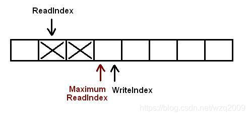

Basically when a new element is going to be written into the queue the producer thread “reserves” the space in the queue incrementing WriteIndex. MaximumReadIndex points to the last slot that contains valid (commited) data.

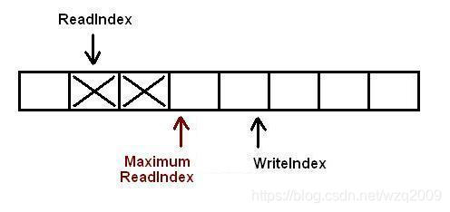

Once the new space is reserved, the current thread can take its time to copy the data into the queue. It then increments the MaximumReadIndex

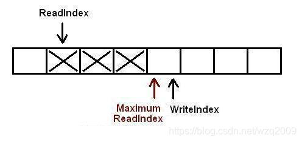

Now there are 3 elements fully inserted in the queue. In the next step another task tries to insert a new element into the queue

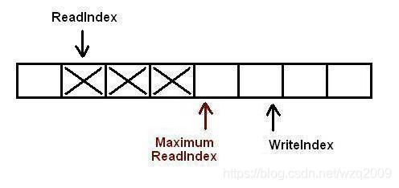

It already reserved the space its data will occupy, but before this task can copy the new piece of data into the reserved slot a different thread reserves a new slot. There are 2 tasks inserting elements at the same time.

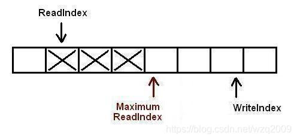

Threads now copy their data in the slot they reserved, but it MUST be done in STRICT order: The 1st producer thread will increment MaximumReadIndex, followed by 2nd producer thread. The strict order constraint is important because we must ensure data saved in a slot is fully commited before allowing a consumer thread to pop it from the queue.

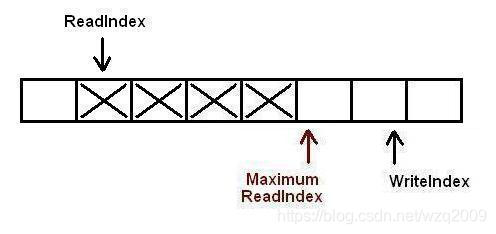

The first thread commited data into the slot. Now the 2nd thread is allowed to increment MaximumReadIndex as well

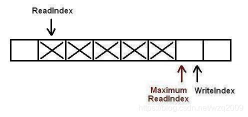

The second thread also incremented MaximumReadIndex. Now there are 5 elements into the queue

#### 3.1.3 Removing elements from the queue

This is the piece of code that removes elements from the queue:

```cpp
/* ... */

template <typename ELEM_T>
bool ArrayLockFreeQueue<ELEM_T>::pop(ELEM_T &a_data)
{
    uint32_t currentMaximumReadIndex;
    uint32_t currentReadIndex;

    do
    {
        // to ensure thread-safety when there is more than 1 producer thread
        // a second index is defined (m_maximumReadIndex)
        currentReadIndex        = m_readIndex;
        currentMaximumReadIndex = m_maximumReadIndex;

        if (countToIndex(currentReadIndex) ==
            countToIndex(currentMaximumReadIndex))
        {
            // the queue is empty or
            // a producer thread has allocate space in the queue but is
            // waiting to commit the data into it
            return false;
        }

        // retrieve the data from the queue
        a_data = m_theQueue[countToIndex(currentReadIndex)];

        // try to perfrom now the CAS operation on the read index. If we succeed
        // a_data already contains what m_readIndex pointed to before we
        // increased it
        if (CAS(&m_readIndex, currentReadIndex, (currentReadIndex + 1)))
        {
            return true;
        }

        // it failed retrieving the element off the queue. Someone else must
        // have read the element stored at countToIndex(currentReadIndex)
        // before we could perform the CAS operation

    } while(1); // keep looping to try again!

    // Something went wrong. it shouldn't be possible to reach here
    assert(0);

    // Add this return statement to avoid compiler warnings
    return false;
}
```

This is the same starting configuration as in the “Inserting elements in the queue” section. There are 2 elements curently inserted into the queue. WriteIndex points to the place where new data would be inserted. ReadIndex points to the slot which would be emptied out in the next call to pop.

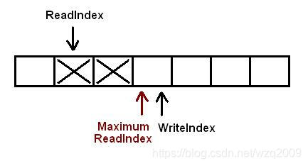

The consumer thread, which is about to read, copies the element pointed by ReadIndex and tries to perform a CAS operation over the same ReadIndex. If the CAS operation succeds the thread retrieved the element from the queue, and since CAS operations are atomic only one thread at a time can increment this ReadIndex. If the CAS operation didn’t succed it will try again with the next slot pointed by ReadIndex

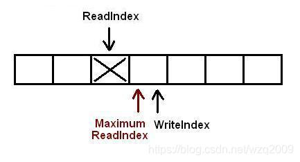

Another thread (or the same one) reads the next element. The queue is empty

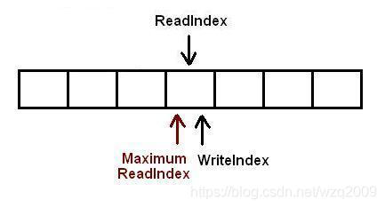

Now a task is trying to add a new element into the queue. It succesfully reserved the slot but the change is pending to be commited. Any other thread trying to pop a value knows the queue is not empty, because another thread already reserved a slot in the queue (writeIndex is not equal to readIndex), but it can’t read the value in that slot, because MaximumReadIndex is still equal to readIndex. This thread trying to pop the value will be looping inside the pop call either until the task that is commiting the change into the queue increments MaximumReadIndex or until the queue is empty again (which can happen if once the producer thread has incremented MaximumReadIndex another consumer thread popped it before our thread tried, so writeIndex and readIndex point to the same slot again)

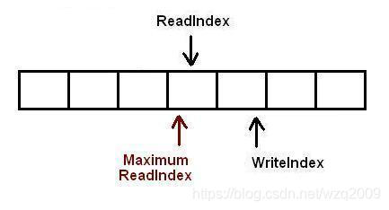

When the producer thread completely inserted the value into the queue, size will be 1 and the consumer thread will be able to read the value

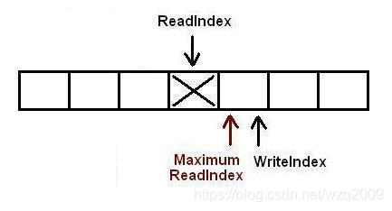

#### 3.1.4 On the need for yielding the processor when there is more than 1 producer thread

The reader might have noticed at this point that the push function may call to a funcion (sched\_yield()) to yield the processor, which might seem a bit strange for an algorithm that claims to be lock-free. As I tried to explain at the beginning of this article, one of the ways multithreading can affect your overall performance is cache trashing. A typical way cache trashing happens whenever a thread is preempted the OS must save into memory the state (context) of the exiting process, and restore the context of the entrant process. But, aside from this wasted time, data saved into cache will be useless for the new process since it was cached for the former existing task.

So, when this algorithm calls to sched\_yield() it is specifically telling the OS: “please, can you put someone else on this processor, since I must wait for something to occur?”. The main difference between lock-free and blocking synchronization mechanisms is supposed to be the fact that we don’t need to be blocked to synchronize threads when working with lock-free algorithms, so why are we requesting the OS to preempt? Answer to this question is not trivial. It is related to how producer threads store new data into the queue: they must perform 2 CAS operations in FIFO order, one to allocate the space in the queue, and an extra one to notify readers they can read data as it has been already “commited”.

If our application has only 1 producer thread (which was what this queue was designed for in the first place), the call to sched\_yield() will never take place, since the 2nd CAS operation (the one that “commits” data in the queue) can’t fail. There is no chance that this operation can’t be done in FIFO order when there is only one thread inserting stuff in the queue (and therefore modifying writeIndex and maximumReadIndex)

The problem begins when there is more than 1 thread inserting elements into the queue. The whole process of inserting new elements in the queue is explained in section 3.1.2, but basically producer threads do 1 CAS operation to “allocate” space in which the new data will be stored and then do a 2nd CAS operation once the data has been copied into the allocated space to notify consumer threads that new data is available to read. This 2nd CAS operation MUST be done in FIFO order, that is, in the same order the 1st CAS operation is done. This is where the issue starts. Let’s think of the following scenario, with 3 producer 1 consumer threads:

- Thread 1, 2 and 3 allocate space for inserting data in that order. The 2nd CAS operation will have to be done in the same order, that is, thread 1 first, then thread 2 and finally thread 3.

- Thread 2 arrives first to the offending 2nd CAS operation though, and it fails since thread 1 hasn’t done it yet. Same thing happens to thread 3.

- Both threads (2 and 3) will keep looping trying to perform their 2nd CAS operation until thread 1 performs it first.

- Thread 1 finally performst it. Now thread 3 must wait for thread 2 to do its CAS operation.

- Thread 2 succeds now that thread 1 is done, its data is totally inserted in the queue. Thread 3 also stops looping since its CAS operation succeded too after thread 2

In the former scenario producer threads might be spinning for a good while trying to perform the 2nd CAS operation while waiting for another thread to do the same (in order). In multiprocessor machines where there are more idle physical processors than threads using the queue it might not be that important: Threads will be stuck trying to perform the CAS operation on the volatile variable that holds the maximumReadIndex, but the thread they are waiting for has a physical processor assigned, so eventually it will perform its 2nd CAS operation while running on another physical processor, and the other spinning thread will succeed also when performing its 2nd CAS operation. So, all in all, the algorithm might hold threads looping, but this behaviour is expected (and desired) since this is the way it works as quick as possible. There is no need, therefore, for sched\_yield(). In fact, that call should be removed to achieve maximum performance, since we don’t want to tell the OS to yield the processor (with the associated overhead) when there is no real need for it.

However, calling to sched\_yield() is very important for the queue’s performance when there is more than 1 producer thread and the number of physical processors is smaller than the amount of total threads. Think of the previous sceneario again, when 3 threads were trying to insert new data into the queue: If thread 1 is preempted just after allocating its new space in the queue but before performing the 2nd CAS operation, threads 2 and 3 will be looping forever waiting for something that won’t ever happen until thread 1 is waken up. Here’s the need for the sched\_yield() call, the OS must not keep threads 2 and 3 looping, they must be blocked as soon as possible to try to get thread 1 to perform the 2nd CAS operation so 2 and 3 can go forward and commit their data into the queue too.

## Known issues of the queue

The main objective of this lock-free queue is offering a way of having a lock-free queue without the need for dynamic memory allocation. It has been succesfully achieved, but this algorithm does have a few known drawbacks that should be considered before using it in production environments.

### 4.1 Using only one producer thread

As it has been described in section 3.1.4 (you must carefully read that section before trying to use this queue with more than 1 producer thread) if there are more than 1 producer thread, they might end up spinning for too long trying to update the MaximumReadIndex since it must be done in FIFO order. The original scenario this queue was designed for had only one producer, and it is definitely true that this queue will show a significant performance drop in those scenarios where there is more than one producer threads.

Besides, if you plan to use this queue with only 1 producer thread, there is no need for the 2nd CAS operation (the one that commits elements into the queue). Along with the 2nd CAS operation the volatile variable m\_maximumReadIndex should be removed, and all references to it changed to m\_writeIndex. So push and pop should be swapped by the following snippet of code:

```cpp
template <typename ELEM_T>
bool ArrayLockFreeQueue<ELEM_T>::push(const ELEM_T &a_data)
{
    uint32_t currentReadIndex;
    uint32_t currentWriteIndex;

    currentWriteIndex = m_writeIndex;
    currentReadIndex  = m_readIndex;
    if (countToIndex(currentWriteIndex + 1) ==
        countToIndex(currentReadIndex))
    {
        // the queue is full
        return false;
    }

    // save the date into the q
    m_theQueue[countToIndex(currentWriteIndex)] = a_data;

    // No need to increment write index atomically. It is a 
    // requierement of this queue that only one thred can push stuff in
    m_writeIndex++;

    return true;
}

template <typename ELEM_T>
bool ArrayLockFreeQueue<ELEM_T>::pop(ELEM_T &a_data)
{
uint32_t currentMaximumReadIndex;
uint32_t currentReadIndex;

do
{
    // m_maximumReadIndex doesn't exist when the queue is set up as
    // single-producer. The maximum read index is described by the current
    // write index
    currentReadIndex        = m_readIndex;
    currentMaximumReadIndex = m_writeIndex;

    if (countToIndex(currentReadIndex) ==
        countToIndex(currentMaximumReadIndex))
    {
        // the queue is empty or
        // a producer thread has allocate space in the queue but is
        // waiting to commit the data into it
        return false;
    }

    // retrieve the data from the queue
    a_data = m_theQueue[countToIndex(currentReadIndex)];

    // try to perfrom now the CAS operation on the read index. If we succeed
    // a_data already contains what m_readIndex pointed to before we
    // increased it
    if (CAS(&m_readIndex, currentReadIndex, (currentReadIndex + 1)))
    {
        return true;
    }

    // it failed retrieving the element off the queue. Someone else must
    // have read the element stored at countToIndex(currentReadIndex)
    // before we could perform the CAS operation

} while(1); // keep looping to try again!

// Something went wrong. it shouldn't be possible to reach here
assert(0);

// Add this return statement to avoid compiler warnings
return false;
}
```

If you plan to use this queue on scenarios were there is only 1 producer and 1 consumer thread, it’s definitely worth it to have a look at \[11\], where a similar circular queue designed to be used in this particular configuration is explained in detail.

### 4.2 Using the queue with smart pointers

If the queue is instantiated to hold smart pointers, note that the memory protected by the smart pointers inserted into the queue won’t be completely deleted (smart pointer’s reference counter equals to 0) until the index where the element was stored is occupied by a new smart pointer. This shouldn’t be a problem in busy queues, but the programmer should take into account that once the queue has been completely filled up for the 1st time, the amount of memory taken up by the application won’t go down even if the queue is empty.

### 4.3 Calculating size of the queue

The original function size might return bogus values. This is a code snippet of it:

```cpp
template <typename ELEM_T>
inline uint32_t ArrayLockFreeQueue<ELEM_T>::size()
{
    uint32_t currentWriteIndex = m_writeIndex;
    uint32_t currentReadIndex  = m_readIndex;

    if (currentWriteIndex >= currentReadIndex)
    {
        return (currentWriteIndex - currentReadIndex);
    }
    else
    {
        return (m_totalSize + currentWriteIndex - currentReadIndex);
    }
}
```

The following scenario describes a situation where this function returns bogus data:

- when the statement currentWriteIndex = m\_writeIndex is run, m\_writeIndex is 3 and m\_readIndex is 2. Real size is 1.

- afterwards this thread is preemted. While this thread is inactive 2 elements are inserted and removed from the queue, so m\_writeIndex is 5 m\_readIndex 4. Real size is still 1.

- Now the current thread comes back from preemption and reads m\_readIndex. currentReadIndex is 4.

- currentReadIndex is bigger than currentWriteIndex, so m\_totalSize + currentWriteIndex - currentReadIndex is returned, that is, it returns that the queue is almost full, when it is almost empty.

The queue uploaded into this article includes the solution to this problem. It consists of adding a new class member containing the current number of elements of the queue, that could be incremented/decremented using AtomicAdd/AtomicSub operations. This solution adds an important overhead since these atomic operations are expensive because they can’t be easily optimized by the compiler.

For intance, in a test run in a core 2 duo E6400 at 2.13 Ghz (2 hardware processors) it takes for 2 threads (1 producer + 1 consumer) to insert 10,000k elements in a lock-free queue initialized to a size of 1k slots about 2.64s without the reliable size variable, and about 3.42s (around 22% more) if that variable is being mantained by the queue. It also takes 22% longer when 2 consumers and 1 producer are used under the same environment: It takes 3.98s for the unreliable-size version of the queue and about 5.15 for the other one.

This is why it has been left up to the developer to activate the overhead of the size variable. It always depends on the kind of application the queue is being used for to decide whether that overhead is worth it or not. There is a compiler preprocessor variable in array\_lock\_free\_queue.h called ARRAY\_LOCK\_FREE\_Q\_KEEP\_REAL\_SIZE. If it is defined the “reliable size” overhead is activated. If it is undefined the overhead will be deactivated and the size function might end up returning bogus values.

## 5. Compiling the code

Both the lock-free queue and the Glib blocking queue included in the article are template-based C++ classes. Templatized code must be in header files so it won’t be compiled until it is used in a .cpp file. I have included both queues in a .zip file which contains a sample file per queue to show its usage, and measure how long it takes for each queue to complete a multithreaded test.

Testing code has been written using gomp, the GNU implementation of the OpenMP Application Programming Interface (API) for multi-platform shared-memory parallel programming in C/C++ \[9\] which is included in GCC since version 4.2. OpenMP is a simple and flexible interface for developing parallel applications for different platforms and it is a very easy way of writing multithreaded code.

So, there are 3 parts in the code attached to this article, each one with different requirements:

1 Array based Lock-free queue:

- There are two separate versions of the lock-free queue. One for any thread configuration, and another one for environments with only 1 producer thread. They are stored in array\_lock\_free\_queue.h and array\_lock\_free\_queue\_single\_producer.h

- GCC newer or equal to 4.1.0 for the atomic operations (CAS, AtomicAdd and AtomicSub). If another compiler is to be used, these operations must be defined in atomic\_ops.h (they might depend either on the compiler or on your platform or both)

- You might also need to define uint32\_t if this type is not included in the implementation of stdint.h of your environment. It is included in GNU-Linux, but it’s not in Windows. In most modern environments all you’ve got to do is:

  ```cpp
  typedef unsigned int uint32_t; // int is (normally) 32bit in both 32 and 64bit machines
  ```

  It’s also important to note here that this queue hasn’t been tested on a 64bit environment. GCC could give compile-time errors if atomic operations are not supported for 64bit type variables, and this is why a 32bit type variable was picked to implement the queue (in 32bit machines there might not be 64bit atomic operations). If your machine supports atomic operations over 64bit variables I don’t see why the queue could fail operating with 64bit indexes

- The lock-free queue for all thread configurations (the one that performs 2 CAS operations per push operation) also makes use of a call to yield the processor: sched\_yield(). According to the documentation this call is part of POSIX \[10\], so any POSIX compliant OS should compile it no problem

2 Glib based blocking queue:

- You will need to have glib available in your system. This is pretty straight forward in GNU-Linux systems, though it can be a more complicated under other platforms systems. There is an ready-to-use package of the whole GTK+ library to be installed in GNU-Linux, Windows and OSX here: http://www.gtk.org/download.html

- It also uses glib implementation of mutexes and conditional variables which are part of the gthread library, so you will also have to link to this when compiling your application if you decided to include this queue

3 test applications:

- Fulfill demanded requirements for both Lock-free and Glib blocking queues

- The GNU make application to process the makefile. You can pass compile-time options to the compiling process, as in

  ```sh
  make N_PRODUCERS=1 N_CONSUMERS=1 N_ITERATIONS=10000000 QUEUE_SIZE=1000
  ```

  Where:

  - N\_PRODUCERS is the number of producer threads.

  - N\_CONSUMERS is the number of consumer threads.

  - N\_ITERATIONS is the total number of items that will be inserted and removed from the queue.

  - QUEUE\_SIZE is the maximum number of slots of the queue

- GCC, at least in version 4.2 to be able to compile Gomp

- It’s also needed to add ‘OMP\_NESTED=TRUE’ to the command line before running the test app, as in `OMP_NESTED=TRUE ./test_lock_free_q`

## 6. A few figures

The following graphs show the result of running the test aplications included in this article in a 2-core machine (2 hardware processors) with different settings and thread configurations.

### 6.1. The impact on performance of the 2nd CAS operation

A known issue of the queue is the spare 2nd CAS operation when there is only one producer thread. The following graph shows the impact of removing it on a 2-core machine when there is only 1 procuder thread (lower is better). It shows an improvement of around 30% in the mount of seconds it takes to insert and extract simultaneously 1 million elements.

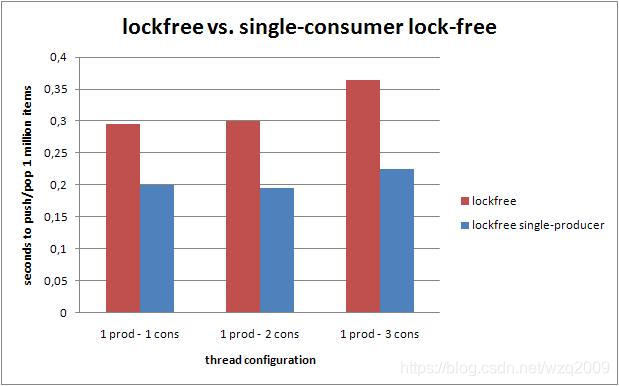

### 6.2. Lock-free vs. blocking queue. Number of threads

The following graph shows a comparison on the amount of time it takes to push and pop simultaneously 1 million elements (lower is better) depending on the set up of threads (queue size has been set to 16384). The lockfree queue outperforms the standard blocking algorithm when there is only one producer thread. When several producer threads (all equally greedy to push elements into the queue) are used, the lockfree queue performance quickly diminishes.

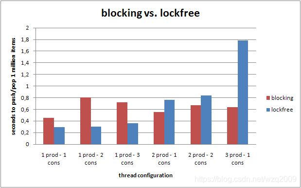

### 6.3. Performance using 4 threads

The following graphs show the overall performance of the different queues when 1 million items are pushed into and pop using different thread configurations.

#### 6.3.1 One producer thread

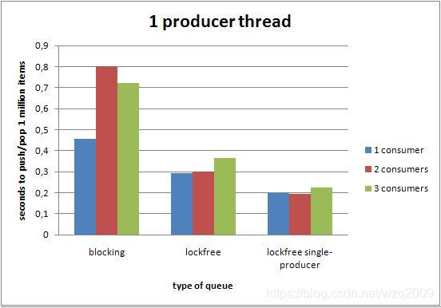

#### 6.3.2 Two producer thread

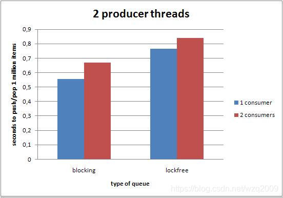

#### 6.3.3 Three producer threads

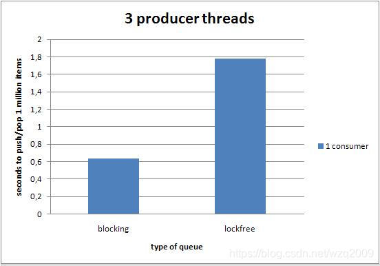

#### 6.3.2 Two consumer thread

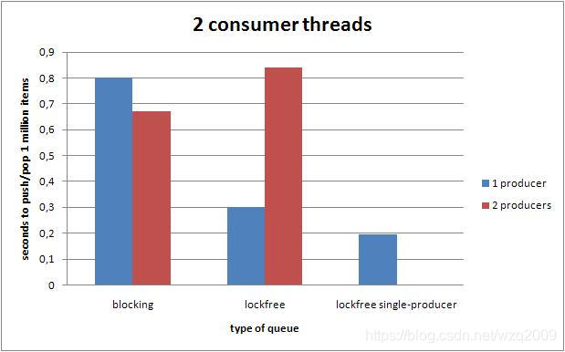

#### 6.3.3 Three consumer threads

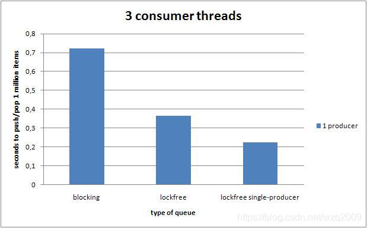

### 6.4 A 4-core machine

It would be good to run the same tests on a 4-core machine to study the overall performance when there are 4 physical processors available. Those tests could also be used to have a look on the performance impact that the sched\_yield() call has when there isn’t real need for it.

## 7. Conclusions

This array based lock-free queue has been proved to work in its 2 versions, the one which is thread safe in multiple producer thread configurations, and the one which is not (the one similar to \[11\] but allowing multiple consumer threads). Both queues are safe to be used as a synchronization mechanism in multithread applications because:

- Since the CAS operation is atomic, threads trying to parallely push or pop elements into/from the queue can’t run into a deadlock.

- Several threads trying to push elements into the queue at the same time can’t write in the same slot of the array, stepping onto each other’s data.

- Several threads trying to pop elements from the queue at the same time can’t remove the same item more than once.

- A thread can’t push new data into a full queue or pop data from an empty one

- Neither push nor pop suffer from the ABA problem.

However it is important to note that even though the algorithm is thread-safe, its performance in multiple producer environments is outperformed by a simple block-based queue. Therefore, choosing this queue over a standard block-based queue makes sense only under one of the following configurations:

- There is only 1 producer thread (the 2nd single-producer versions is faster).

- There is 1 busy producer thread but we still need the queue to be thread-safe because under some circumstances a different thread could push stuff into the queue.

## 9. References

\[1\] Love, Robert: “Linux Kernel Development Second Edition”, Novell Press, 2005

\[2\] Introduction to lock-free/wait-free and the ABA problem

\[3\] Lock Free Queue implementation in C++ and C#

\[4\] High performance computing: Writing Lock-Free Code

\[5\] M.M. Michael and M.L. Scott, “Simple, Fast, and Practical Non-Blocking and Blocking Concurrent Queue Algorithms,” Proc. 15th Ann. ACM Symp. Principles of Distributed Computing, pp. 267-275, May 1996.

\[6\] The Hoard Memory Allocator

\[7\] Glib Asynchronous Queues

\[8\] boost::shared\_ptr documentation

\[9\] GNU libgomp

\[10\] sched\_yield documentation

\[11\] lock-free single producer - single consumer circular queue

